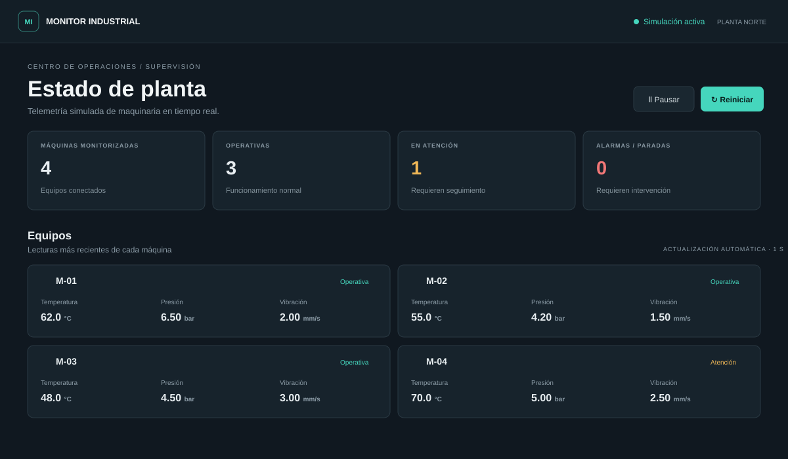

# Monitor Industrial

## Qué problema resuelve

Permite probar una vista de supervisión industrial sin conectar máquinas reales: simula la telemetría de cuatro equipos, detecta umbrales de temperatura, presión y vibración, y presenta estados y alertas en un dashboard local.

## Captura



Vista ilustrativa; los valores de la aplicación se generan de forma aleatoria.

## Cómo ejecutarlo (3 comandos)

Requiere Node.js 18 o superior. Desde la raíz del repositorio:

```bash
cd simulador
npm test
npm start
```

Después abre `http://127.0.0.1:3000` en el navegador. Para cambiar el puerto, define `PORT` antes de iniciar el segundo comando (por ejemplo, `$env:PORT=3001` en PowerShell).

## Arquitectura

```text
┌────────────────────┐     GET /api/lecturas      ┌────────────────────┐
│ Navegador           │ ◄──────────────────────── │ Servidor Node.js   │
│ HTML / CSS / JS     │ ─── POST /api/control ──► │ HTTP + estado      │
└────────────────────┘                            └─────────┬──────────┘
                                                            │ cada segundo
                                                  ┌─────────▼──────────┐
                                                  │ Generador de       │
                                                  │ telemetría y alertas│
                                                  └────────────────────┘
```

El servidor usa únicamente módulos nativos de Node.js y sirve la interfaz y la API desde el mismo origen.

## Decisiones tomadas

- **Sin dependencias de ejecución:** HTTP, temporizador y archivos estáticos usan Node.js nativo para que la demo sea fácil de instalar y ejecutar.
- **Generación centralizada en el servidor:** el navegador recibe las mismas lecturas a través de una API y los controles pausar/reanudar/reiniciar afectan a una única simulación.
- **Umbrales en el generador existente:** reutiliza `src/generador.js` para mantener juntas la generación, la clasificación y las alertas.
- **Actualización periódica con polling:** una petición por segundo es suficiente para una demo sencilla, sin añadir WebSockets.
- **Interfaz en español y adaptable:** prioriza la lectura rápida de estados, métricas y alertas en escritorio y móvil.

## Limitaciones conocidas

- Los datos son sintéticos y se pierden al detener el proceso; no hay persistencia ni conexión con sensores.
- El estado de la simulación vive en memoria y es compartido por todos los navegadores conectados a esa instancia.
- La interfaz consulta cada segundo; no se garantiza una entrega inmediata de eventos.
- No hay autenticación, usuarios, configuración de umbrales ni historial descargable. El servidor escucha solo en `127.0.0.1`, por lo que está pensado para uso local.
- Las probabilidades y umbrales son ilustrativos y no sustituyen criterios de seguridad industrial.

## Próximos pasos

1. Conectar una fuente de telemetría real y validar unidades y umbrales con responsables de planta.
2. Añadir persistencia e histórico con filtros temporales.
3. Incorporar configuración de máquinas y umbrales, y pruebas de integración de la interfaz.
4. Añadir autenticación y controles de acceso antes de cualquier despliegue en red.
